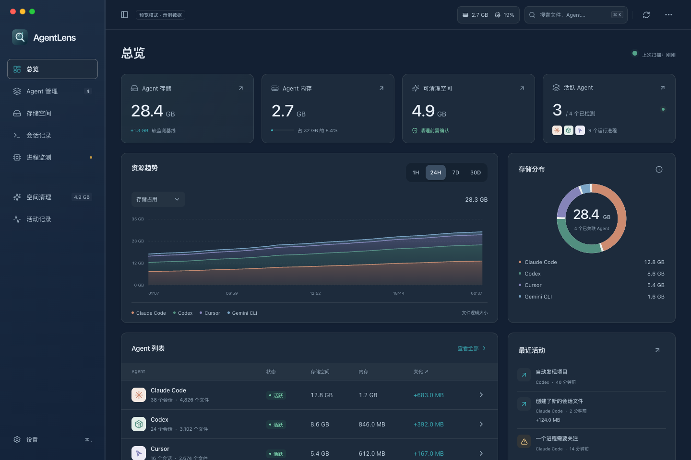
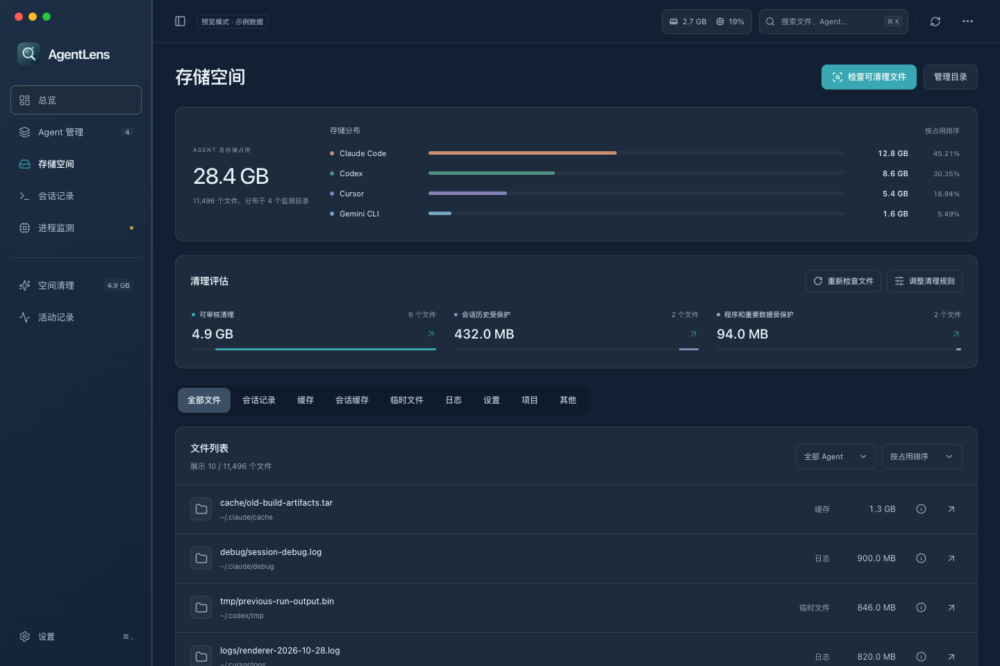
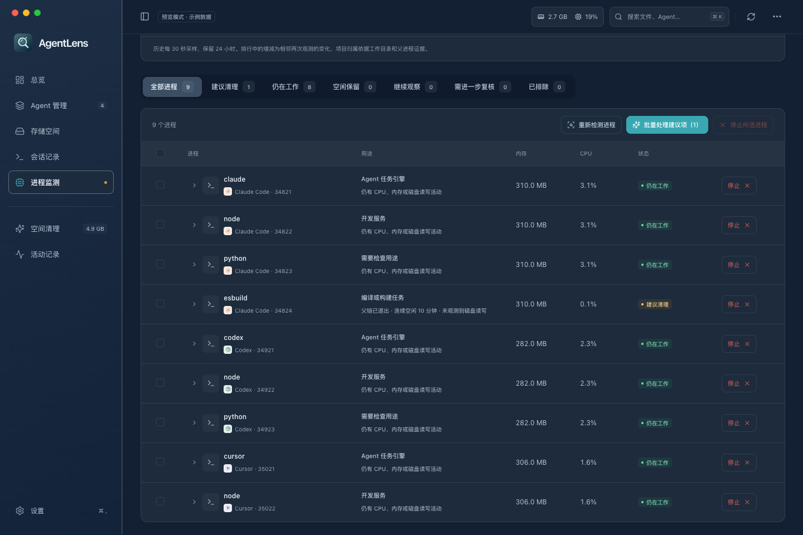
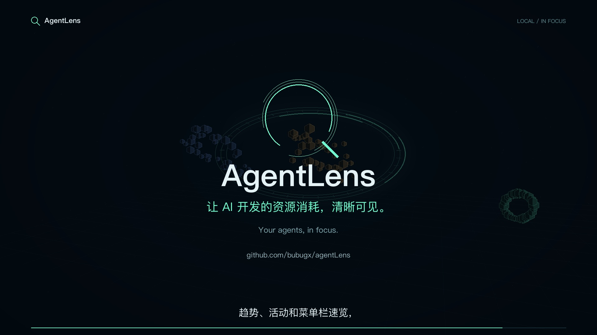
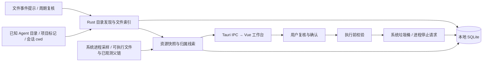

<p align="center"></p>
<h1 align="center">AgentLens</h1>
<p align="center"><strong>Your agents, in focus.</strong><br />让 AI 开发的资源消耗，清晰可见。</p>
<p align="center">本地运行的 AI Agent 资源监测与清理工作台。<br />看清磁盘与内存占用，追踪项目和进程，有依据地整理开发环境。</p>
<p align="center">
  <a href="https://github.com/bubugx/agentLens/releases/latest">下载安装</a> ·
  <a href="#快速开始">快速开始</a> ·
  <a href="#功能一览">功能一览</a> ·
  <a href="#工作原理">工作原理</a> ·
  <a href="docs/implementation.md">实现说明</a> ·
  <a href="docs/media/agentlens-intro-zh.mp4">观看介绍视频</a>
</p>



> 当前版本 **0.1.0**。从 [GitHub Releases](https://github.com/bubugx/agentLens/releases/latest) 获取桌面包，或从源码运行。桌面端采集本机真实数据；浏览器预览使用明确标识的示例数据。发布目标包含 macOS Apple Silicon / Intel、Windows x64 和 Linux x64；平台可用性以实际构建结果和附件为准。

## 为什么做 AgentLens

当 Codex、Claude Code、Cursor 等工具成为日常开发环境的一部分，资源消耗也开始分散：会话记录在增长，缓存散落在不同目录，构建任务和子进程可能在主任务结束后继续运行。

你能在系统监视器里看到一个 `node` 或 `python`，却未必知道它属于哪个工具、在做什么；也能找到一个大目录，却难以判断里面哪些文件应该保留。

AgentLens 把这些线索放进同一个工作台，帮助你回答三个问题：

- **谁在占用资源？** 按 Agent 查看磁盘、进程 RSS、CPU 和变化趋势。
- **占用从哪里来？** 从工具下钻到项目、目录、文件和进程解释。
- **现在能做什么？** 先检查保留原因和清理规则，再确认清理或停止进程。

## 设计理念

**先看见，再行动。** 把总量、变化、归属和操作放在连续的使用路径里，让清理和进程管理有上下文。

**用证据解释判断。** 目录规则、会话元数据、可执行文件与已观测的进程父链共同提供线索。证据不足的项目单列为「未归属项目」，持续增长只提示检查，不直接认定为内存泄漏。

**保守处理文件。** 默认保护项目源码、配置、凭据、数据库和会话历史。候选文件经过规则筛选、稳定观测和执行前复核；清理只移入系统垃圾桶，失败时逐项报告。

**数据留在本机。** 无需账号，没有监测数据上传。SQLite 保存本地索引、历史、偏好与操作记录；会话解析只提取有限元数据，不保存提示词和对话内容。

## 功能一览

| 能力 | 可以做什么 | 带来的价值 |
| --- | --- | --- |
| 资源总览 | 查看 Agent 存储、RSS、CPU、活跃数量和趋势 | 快速定位占用集中在哪个工具 |
| 项目与文件索引 | 自动发现已有项目，按目录、分类与路径搜索、下钻 | 从占用数字追溯到具体文件 |
| 清理诊断 | 展示可清理、运行中、保留期内、会话历史、受保护等原因与分布 | 理解为什么能清理、为什么要保留 |
| 自动进程分析 | 互斥分类显示工作、保留、观察、复核、建议处理与排除；持续核验遗留任务 | 减少逐个检查，保留需要运行的服务 |
| 自定义接入 | 从运行进程或精确可执行文件规则接入，预览进程树并绑定目录 | 没有 CLI 的桌面应用也能统一监测 |
| 可复核的操作 | 清理预览、确认、再次校验、移入垃圾桶；停止前核对进程身份 | 减少误操作，并保留操作记录 |
| 本地历史 | 趋势、活动变化、按 Agent 汇总和时间范围筛选 | 观察开发环境如何随时间变化 |
| 后台速览 | 关闭窗口后继续监测，菜单栏 / 托盘查看资源与快捷入口 | 开发过程中随时掌握占用 |
| 语言与主题 | 简体中文 / English，亮色 / 暗色 / 自定义配色 | 适应不同工作习惯 |

### 支持识别的工具

| 工具 | 默认全局目录示例 |
| --- | --- |
| Codex | `$CODEX_HOME` 或 `~/.codex` |
| Claude Code | `~/.claude` |
| Cursor | `~/.cursor`，以及系统中的已知缓存与工作区目录 |
| Gemini CLI | `~/.gemini` |
| OpenCode | `~/.local/share/opencode` |
| Aider | `~/.aider` |

除内置工具外，可通过「Agent 管理 → 接管 Agent」添加其他应用。已实际验证 Lumo：匹配应用内的可执行文件，脚本入口留空，聊天与附件目录仅监测，日志目录单独评估。见 [桌面应用接入指南](docs/agent-adoption.md)。

还会结合系统缓存位置、项目标记、会话工作目录与进程信息补充发现。**识别覆盖受工具版本、安装方式、目录布局和系统权限影响**；支持识别某工具，不代表能关联它产生的全部文件或每一个会话。

### 界面预览

| 存储与清理诊断 | 进程用途与识别依据 |
| --- | --- |
|  |  |

图中为功能界面演示，示例数据不代表你的机器占用，也不构成清理收益承诺。

## 介绍视频

[](docs/media/agentlens-intro-zh.mp4)

中文旁白与字幕，1080p，30 fps，时长小于 80 秒，旁白采用约 1.6 倍语速。新版以资源碎片穿过镜头、形成归属轨道的连续动画串联动机、资源追踪、自动观测、自定义接入与可复核清理，穿插真实界面操作；不讲解技术栈。界面使用标明的预览数据。[视频说明、脚本与重建方式](docs/video/README.md)。

## 快速开始

### 下载安装包

前往 [最新正式版](https://github.com/bubugx/agentLens/releases/latest)，选择对应架构的 DMG、Windows 安装程序、DEB 或 AppImage。各版本附带更新记录与 `SHA256SUMS.txt`。安装、签名状态、版本规则和维护者发布步骤见 [版本与发布](docs/releases.md)。

### 从源码运行

- **Node.js 22+** 与 npm。
- **Rust stable，至少 1.88**（桌面端需要）。
- 对应操作系统的 [Tauri 2 系统依赖](https://v2.tauri.app/start/prerequisites/)：macOS 安装 Command Line Tools；Windows 需要 C++ 构建工具和 WebView2；Linux 需要 WebKitGTK 等依赖。

在项目根目录运行：

```sh
npm ci
npm run desktop
```

首次启动用镜头与资源信号动画展示真实的发现、索引和保存阶段，支持暂停，也尊重减少动态效果偏好。应用会发现可访问用户目录中的已有项目，并建立文件索引。macOS 访问桌面、文稿等目录时可能请求系统授权；拒绝后仍会扫描可访问范围，并标明结果不完整。

### 只体验界面

```sh
npm ci
npm run dev
```

打开终端提示的地址，默认为 [http://127.0.0.1:1421](http://127.0.0.1:1421)。浏览器始终显示「预览模式 · 示例数据」，清理和停止进程只改变页面中的样例状态。真实资源监测需要桌面端。

### 建议的首次使用路径

1. 等待首次索引完成，在「总览」查看资源分布；如有权限警告，先确认统计覆盖范围。
2. 在「设置 → 监测目录」检查发现范围；在「Agent 管理」接入其他桌面应用或自定义工具。
3. 打开「存储空间」与「进程监测」，从较大的占用开始检查来源和用途。
4. 在「空间清理」查看诊断与规则，选择候选文件，复核后确认移入垃圾桶。
5. 保持后台监测，通过趋势、活动记录和菜单栏速览观察后续变化。

## 工作原理



| 层次 | 主要实现 | 责任 |
| --- | --- | --- |
| 交互层 | Vue 3 Composition API、TypeScript、Reka UI | 页面、趋势图、诊断、筛选、确认与主题 |
| 桌面层 | Tauri 2、系统 WebView | 窗口、菜单栏 / 托盘、目录选择、系统集成和 IPC |
| 采集与决策层 | Rust、sysinfo、walkdir、notify | 项目发现、文件分类、进程采样、候选评估和身份校验 |
| 持久层 | SQLite / rusqlite、WAL | 索引、偏好、基线、历史、活动与操作 journal |

资源采样默认 **5 秒**一次；目录变化合并后复核，扫描提交之间至少间隔 **30 秒**，无事件时每 **5 分钟**复核。扫描与资源采样使用独立后台任务；文件扫描按 CPU 核心数使用 2–6 个工作线程，进度通知节流，SQLite 事务只更新变化的文件记录。

详细的分类规则、历史采样、清理流程、数据口径与源码导航见 [实现说明](docs/implementation.md)。

## 清理与数据边界

- **候选需要同时满足多项条件。** 命中明确规则、超过保留期、至少两次间隔 10 秒的稳定观测、所属 Agent 未运行，并且是可核验身份的普通单硬链接文件。候选仍需用户确认。
- **零候选也有解释。** 正在运行的 Agent 会阻止其文件进入清理候选，退出后自动重新评估；尚在保留期或等待稳定观测的文件会说明原因，不要求逐个打开排查。
- **默认保留重要数据。** 应用安装资源、源码、配置、凭据、数据库、符号链接和未识别的项目产出受保护；会话历史默认不清理，需显式开启，项目内会话另有开关。
- **清理先移入垃圾桶。** 预览计划 60 秒内有效；执行时再次检查文件、祖先目录、规则和 Agent 状态。部分失败会报告，中断操作重启后提示人工复核。**移入垃圾桶不会立即释放磁盘空间，清空系统垃圾桶后才会释放。**
- **占用有明确口径。** 文件统计为监测范围内的逻辑大小；RSS 可能重复计算共享页面。目录归属表示路径或项目关联，不能证明所有文件由某次 Agent 会话生成。
- **历史从实际观察开始。** 首次索引建立磁盘基线，不能恢复安装前的 CPU / RAM 时间序列。未观测到父链的独立进程可能无法归属；进程与具体会话暂无通用可靠映射。

文件系统操作仍存在同权限进程并发替换路径的残余风险，具体校验方式与限制见 [清理执行边界](docs/implementation.md#清理执行边界)。

## 开发与验证

```sh
npm run version:check
npm run format:check
npm run build
npm test
cargo test --manifest-path src-tauri/Cargo.toml --lib
npm run test:e2e
```

Playwright 默认使用本机 Google Chrome，自动启动或复用 Vite；可在 [playwright.config.ts](playwright.config.ts) 中调整浏览器 channel。测试覆盖导航、筛选、趋势、清理确认、进程停止、语言与主题、目录管理、分页、扫描状态和弹层交互。

运行真实采集探针（不执行清理）：

```sh
npm run probe -- /tmp/agentlens-isolated-probe
```

本轮本地验证：37 项 Rust 测试、13 项前端测试、26 项 Playwright 交互用例通过。覆盖完整分类计数、稳定观测、成功零 I/O、安装资源保护、JSONL 日志、自定义接入、身份变化与清理边界。原始本机报告属于本地验收材料，保存在忽略的 `artifacts/` 中。

### 构建与发布桌面包

```sh
npm run desktop:build -- --bundles dmg       # macOS
npm run desktop:build -- --bundles nsis      # Windows
npm run desktop:build -- --bundles deb,appimage  # Linux
```

产物位于 `src-tauri/target/release/bundle/`。macOS 当前使用 ad-hoc 签名，尚未 Developer ID 签名或公证。日常 CI 检查源码；`v*` 标签触发独立发布流程，先校验版本并创建草稿，再构建所有平台，最后生成校验文件并发布到 GitHub Releases。失败时保留草稿。[完整发布说明](docs/releases.md)。

### 源码导航

```text
src/
  App.vue                 页面组织、订阅和操作确认
  components/             总览、文件、进程、清理、活动与设置
  lib/client.ts           Tauri 调用与浏览器预览适配
  lib/types.ts            数据类型、展示工具与增长判断
  lib/demo.ts             明确隔离的示例数据
src-tauri/src/
  lib.rs                  后台调度、IPC、清理执行、托盘与窗口
  collector.rs            目录规则、文件分类、会话元数据、进程识别
  inventory.rs            并发发现、索引与扫描进度
  store.rs                SQLite 索引、历史和操作记录
  model.rs                Rust 数据模型与默认策略
  adoption.rs             自定义识别规则、进程树接管与目录边界
  process_analysis.rs     连续观测、I/O 证据与建议分类
  resources.rs            项目归属、资源历史与停止前复核
tests/                   Playwright 交互检查
scripts/                 统一版本号、发布附件校验
.github/workflows/       日常检查与标签发布
docs/                    当前设计、使用指南、精选截图和视频源码
artifacts/               本地验收与中间产物（已忽略）
```

## 参与贡献

欢迎改进工具识别、平台兼容、进程用途解释、交互、多语言与文档。提交问题时请描述操作系统、工具版本、复现步骤、预期结果与实际结果，并在截图或日志中隐去本机敏感路径和内容。涉及识别或清理规则的修改，请说明匹配证据、保护范围与验证方式。

贡献约定见 [CONTRIBUTING.md](CONTRIBUTING.md)。当前尚未提供 `LICENSE` 文件，许可证需由项目作者明确；依赖项遵循各自许可证。

## 更多资料

- [当前实现与设计取舍](docs/implementation.md)
- [桌面应用与自定义 Agent 接入](docs/agent-adoption.md)
- [进程分类与清理判断](docs/interface-refinement-and-process-classification.md)
- [资源历史与通知](docs/resource-analysis-and-notifications.md)
- [版本、安装与 GitHub Release](docs/releases.md) · [更新记录](CHANGELOG.md)
- [介绍视频、旁白与制作说明](docs/video/README.md)

README 的组织参考了 [uv](https://github.com/astral-sh/uv)、[Tauri](https://github.com/tauri-apps/tauri) 与 [LocalSend](https://github.com/localsend/localsend)：简洁定位、直达下载、可见演示、可执行的快速开始，以及独立维护的实现与发布文档。
