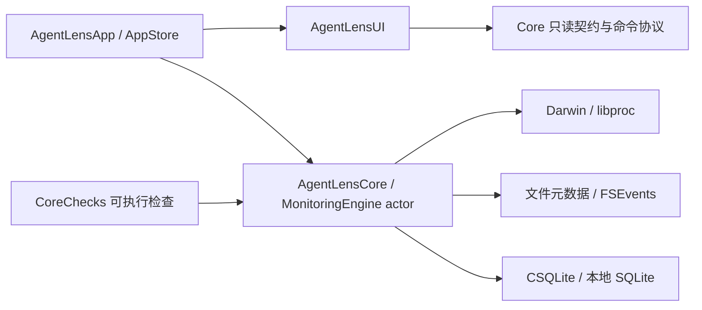
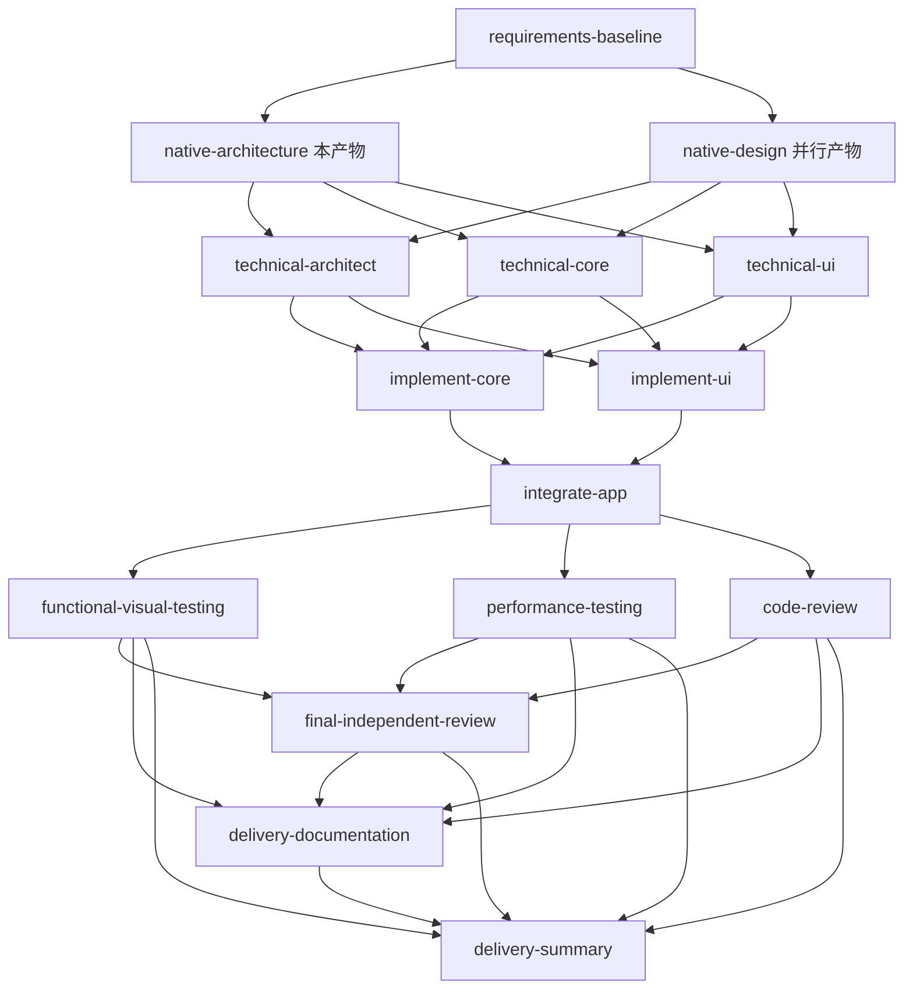

# AgentLens 原生架构决策

本阶段：`native-architecture`；作者：architect；2026-11-16。状态为**架构决策已形成，等待技术评审，尚未实现客户端**。文件写入范围仅为 `docs/architecture`。

需求依据：REQ-0004，`e6fd1238-c806-45c9-ad3d-50280611b915`，读取时 revision **2**、documentRevision **1**、状态 `ready`。已通过 bound/get 核对正文及 req-1～req-9。本阶段不修改需求正文、不推进其他角色的验收状态。

## 1. 已核验事实与决策

| 项目 | 本机实测事实 | 决策或限制 |
| --- | --- | --- |
| 系统 | macOS 14.4.1，23E224 | 最低部署 macOS 14.0；本轮运行核验仅覆盖 14.4.1 |
| 硬件 | arm64，MacBookPro18,1，16 GiB | 首版本地交付以 Apple Silicon 为已验证目标；Intel 运行未验证 |
| 工具链 | Swift 5.10，macOS SDK 14.4，Command Line Tools | SwiftPM 作为可重复构建入口，不依赖 Xcode 工程生成器 |
| 完整 Xcode | `xcodebuild -version` 失败：当前 developer directory 是 CLT | 不将 xcodebuild/GUI Xcode 作为本机必经路径 |
| 原生依赖 | SwiftUI、AppKit、Charts、Observation、MenuBarExtra、Material 编译链接通过 | UI 使用系统框架，无 WebView/Electron 运行时 |
| 采集 | libproc 本进程 RSS、BSD 启动身份、host_statistics64、内存压力 sysctl 读取成功 | 其他进程的可读性仍需逐进程验证，不能从本进程成功推断 |
| 存储 | 系统 SQLite 3.43.2 内存库打开成功 | 使用 SQLite C 接口和极小 systemLibrary shim，无第三方包 |
| 液态玻璃 | Apple 官方 API 元数据标明 macOS 26.0 引入；本机 SDK 无 `glassEffect` | SDK 编译条件与运行时可用性双重隔离；本机使用 Material/不透明回退 |
| 行为测试 | `import XCTest` 编译失败；SwiftPM 另有 XCTest 路径警告 | 本机使用独立可执行行为检查目标，退出码判定，不伪造 XCTest 通过 |
| 本机界面工具 | computer_apps 成功；computer_screenshot 收到真实 PNG；computer_snapshot 被辅助功能权限阻断 | 可做截图观察；当前无法做 AX 控件读取/点击，后续交互验收需补权限或记录人工证据 |
| 初始项目 | 探测时 `~/workspace/AgentLens` 不存在；已检查的上级及项目 AGENTS.md 不存在 | 本阶段仅建立架构文档目录；应用工程由后续实现任务创建 |

原始结果见 [evidence/environment.json](evidence/environment.json)、[evidence/probe-results.json](evidence/probe-results.json)、[evidence/capabilities.json](evidence/capabilities.json)。探针只验证技术路径，未打开测试窗口、未扫描用户文件内容、未执行废纸篓动作，也不代表 req-8 性能达标。

## 2. 技术选择

| 方案 | 与本次目标的关系 | 取舍 |
| --- | --- | --- |
| SwiftUI + AppKit + SwiftPM | 系统菜单栏、辅助功能、原生材质、Darwin 采集、低常驻开销；当前工具链可构建 | **采用**。AppKit 补生命周期、目录选择与窗口恢复，SwiftUI 实现页面和图表 |
| Tauri + Web UI + 原生扩展 | 可复用 Web 开发经验，但采集、废纸篓、菜单栏和真液态玻璃仍需原生桥接 | 本项目无现成 Web 资产，桥接与双状态成本没有收益 |
| Electron | 桌面生态成熟，但自带运行时增加常驻资源预算压力 | 与 150 MiB RSS 目标存在额外风险，当前无采用理由 |

这里是成本与依赖评估，不是后三者的实测性能比较。

采用单进程、无提权服务、无登录启动项、无网络服务的原生工具。本地开发产物不启用 App Sandbox，以便按用户选择监测普通目录和读取允许访问的进程信息；仍完整服从 TCC、POSIX 权限与系统限制。授权不足只展示状态和重新选择目录入口，不要求 root、不调用 sudo，不将 Full Disk Access 作为首次启动前置条件。沙盒/App Store 发布不是此次构建方案，若后续要求，需要重评估目录授权和进程采集范围。

## 3. 工程与依赖边界

建议由实现角色建立以下 SwiftPM targets；本阶段未创建这些源码文件。

```text
Package.swift                         swift-tools-version: 5.10; macOS(.v14)
Sources/CSQLite/{module.modulemap,shim.h}
Sources/AgentLensCore/                 Foundation / Darwin / CoreServices / CSQLite
Sources/AgentLensUI/                   SwiftUI / Charts / AppKit / AgentLensCore
Sources/AgentLensApp/                  @main App、AppDelegate、AppStore、窗口与授权协调
Tests/AgentLensCoreChecks/             executableTarget，真实隔离夹具和退出码
scripts/build-app.sh                   swift build、组装 .app、ad-hoc 签名、验证
Resources/Info.plist                   bundle 信息与最低系统版本
dist/AgentLens.app                     后续集成产物
```



UI 不扫描路径、不读写 SQLite、不自行按 PID 聚合、不删除文件。Core 不引用 SwiftUI 或窗口生命周期。App 负责注入同一个 MonitoringEngine，维护单个 AppStore，并将目录选择、打开 Finder、恢复主窗口和明确退出映射为系统操作。协议与数据语义详见 [接口契约](interfaces.md)。

## 4. 状态所有权与生命周期

- `MonitoringEngine actor` 是配置、基线、目录代次、进程采样、候选和清理计划的唯一业务状态所有者；SQLite 单写入通道与其协调，避免双写。
- 阻塞文件枚举和 SQLite 工作在有界 utility worker 上执行，不在 MainActor 或 actor 的长同步方法中遍历磁盘。任一时刻最多一个全目录扫描任务；待扫描工作按根/子树合并，不为每个事件新建任务。
- `@MainActor AppStore` 只保存最近不可变快照、查询页、选择项和显示状态。它消费一个 `AsyncStream`（bufferingNewest(1)）；主窗口与菜单栏共享同一实例。被合并的 UI 通知不影响 Core 已提交的索引和历史。
- 引擎由 App 生命周期启动，不能放在主窗口 `.task`/`.onAppear` 下。最小化/关闭窗口不会取消采样；`applicationShouldTerminateAfterLastWindowClosed` 返回 false。保持正常 Dock 应用和常驻 MenuBarExtra，菜单内有“打开 AgentLens”“退出 AgentLens”。
- 明确退出：先停止接受新清理命令、撤销待执行计划，取消时钟和 FSEvents、合作取消扫描、提交已完成事务，再结束应用。正在执行的单项废纸篓操作等待其返回；终止异常的 journal 在重启时复核。退出清理不阻塞 MainActor，也不无限等待重试。
- 唤醒后标记睡眠区间、立即刷新系统和目录；不把睡眠期间的缺口画成连续实时采样。运行中新鲜度和 debounce 用单调时钟，持久化/展示用 UTC Date；系统时钟回拨建立新时间段。

## 5. 兼容与液态玻璃

支持路径分为两个构建条件，二者共享同一业务代码和最低部署目标。

| 构建工具链 | 运行系统 | 行为 | 验证状态 |
| --- | --- | --- | --- |
| Swift 5.10 / SDK 14.4 | macOS 14.4.1 arm64 | SwiftUI Material；减少透明度时不透明语义背景 | 框架构建与数据 API 已验证，应用视觉待实现验收 |
| Swift 5.10 / SDK 14.4 | macOS 26 | 仍为旧 SDK 回退构建，不声称启用自定义液态玻璃 | 未运行 |
| Swift 6.2+ / SDK 26+ | macOS 14～15 | 运行时回退 | 待新工具链构建和系统实测 |
| Swift 6.2+ / SDK 26+ | macOS 26+ | 可使用官方 `glassEffect`；减少透明度优先走不透明背景 | 官方版本依据已核对，编译和视觉均待验证 |
| 任一受支持工具链 | Intel | 源码无架构专用汇编；需 x86_64 构建及真实设备测试 | 本轮未验证，不列为已验证兼容范围 |

构建脚本仅当 SDK major ≥26 且 Swift compiler ≥6.2 时添加 `-Xswiftc -DAGENTLENS_HAS_LIQUID_GLASS`；SDK 版本从 xcrun 查询并按数字比较，不能仅按当前运行系统或字符串比较。UI 单一材质适配器使用：

```swift
// 所有分支先判断 accessibilityReduceTransparency；开启时使用不透明语义色。
#if compiler(>=6.2) && AGENTLENS_HAS_LIQUID_GLASS
if #available(macOS 26.0, *) {
    content.glassEffect(.regular, in: RoundedRectangle(cornerRadius: radius))
} else {
    content.background(.regularMaterial)
}
#else
content.background(.regularMaterial)
#endif
```

旧 SDK 的 `#available` 单独防护失败已有负向编译证据，双条件旧 SDK 分支 typecheck 成功。上面新 SDK 分支依据官方 API 声明，尚未在 SDK 26 编译，不应在后续交付中写成已通过。液态玻璃集中于导航、工具条和菜单浮层；图表和大面积内容优先保持语义背景与文字对比。减少动态效果时取消非必要形变/动画。真实设计节点及视觉尺寸由 native-design 产物和后续 technical-architect 评审确定，此阶段不替设计角色验收。

## 6. 构建与验证入口约定

后续集成任务提供 `scripts/build-app.sh`，按以下顺序执行并保存真实日志：

1. 核验工具链与 SDK，选择材质编译条件。
2. `swift build -c release --product AgentLens`；用 `swift build -c release --show-bin-path` 找二进制，不硬编码 arm64 目录。
3. 组装 `dist/AgentLens.app/Contents/{MacOS,Resources}` 和 Info.plist。可执行文件与 CFBundleExecutable 一致，最低系统 14.0，bundle ID 建议 `local.agentlens.app`。
4. `codesign --force --sign - dist/AgentLens.app`；`codesign --verify --strict --verbose=2 dist/AgentLens.app`。本轮未执行应用签名，不承诺公证或外部分发。
5. `open dist/AgentLens.app`，由独立测试者检查主窗口、菜单栏和退出；成功链接或进程存在不能替代实际交互证据。
6. `swift run -c release AgentLensCoreChecks` 为本机行为检查入口。若将来安装完整 Xcode，可增设 XCTest，但不能以删除行为检查或放宽预算替代验证。

复现探针见 [evidence/probe](evidence/probe)。它可独立 `swift build -c release` / `swift run -c release --skip-build Probe`，只用于接口可行性，不是 AgentLens 应用或应用测试替身。

## 7. 后续评审消费顺序



这是对宿主既有任务依赖的说明，不新增任务或授予文件权限。架构、Core、UI 的三项技术评审必须在实现前共同对齐契约，尤其核对候选安全边界、无 XCTest 环境和液态玻璃验收缺口。
