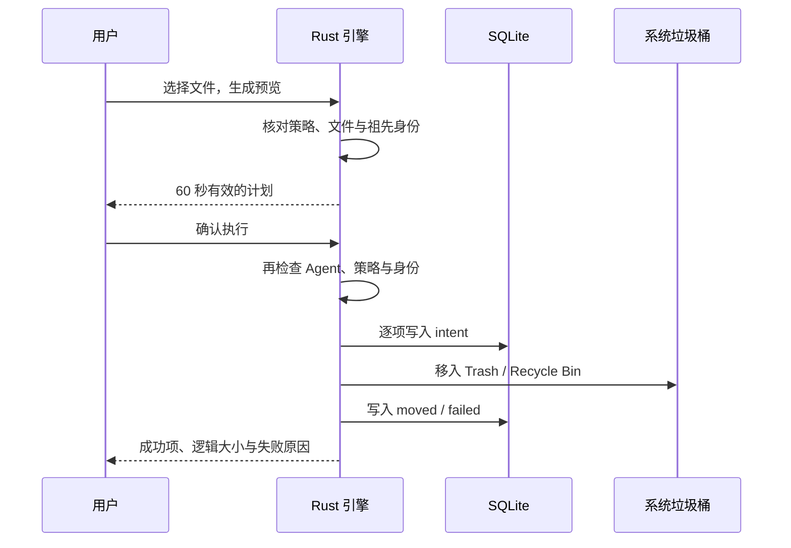

# AgentLens：实现与设计取舍

本文对照当前 Vue / Tauri / Rust 源码，说明资源数据如何产生、如何解释，以及操作前做了哪些检查。产品入口与运行方式见 [README](../README.md)。

## 从使用问题到实现选择

| 使用问题 | 实现选择 | 取舍 |
| --- | --- | --- |
| 多个 Agent 的资源信息分散 | 目录、项目、会话元数据和进程采样组合成统一快照 | 路径关联不等于完整的文件写入归因 |
| 一个 node / python 难以理解 | 可执行文件直接匹配，追踪同用户且启动时间合理的父链 | 应用启动前已失去父链的进程可能无法识别 |
| 大文件是否能删除难以判断 | 分类、保留期、稳定性与运行状态共同决定候选，并展示原因 | 保守规则可能留下可以人工清理的文件 |
| 首次扫描可能很大 | 有界并发、阶段进度、取消代次、事务提交与增量索引更新 | 系统授权调用可能等待用户作答 |
| 希望开发中持续观察 | 后台采样、文件事件合并、菜单栏速览、本地历史 | 关闭窗口后仍运行，需从托盘菜单退出 |
| 不希望上传项目或对话 | 本地 SQLite；会话只提取有限 ID / cwd 元数据 | 不提供完整的会话执行轨迹 |

## 前端与桌面边界

`src/lib/client.ts` 以 `isTauri()` 区分环境：桌面通过 IPC 获取快照和提交操作，订阅 `snapshot`、`scan-progress` 事件；浏览器使用 `demoSnapshot()`，操作仅影响当前页面的示例状态。

Vue 3 Composition API 组织各页面。Reka UI 提供选择器的键盘导航、焦点、Portal 与边缘避让。支持简体中文 / English、亮色 / 暗色 / 自定义配色，本地保存偏好。Tauri 负责系统 WebView、目录选择、文件定位、窗口、托盘与材质。macOS 材质按能力回退，不保证各系统具有相同的 Liquid Glass 效果。

## 目录发现与索引

全局规则发现六类工具的已知目录，并考虑 `CODEX_HOME`、系统缓存与配置位置。首次遍历可访问的用户空间，通过 Git、项目清单和 Agent 标记发现已有项目；后续结合会话 cwd、进程工作目录和 Git 根补充发现。

无明确 Agent 证据的项目归为「未归属项目」。自动发现去重并限制数量；手动移除后保存排除记录，也可手动添加主目录内的项目。发现跳过系统数据、依赖、构建产物、缓存树与符号链接；项目盘点排除 `.git`、`node_modules`、`target`、`.next`、`dist`、`venv`、`.venv`，文件遍历不跨挂载卷。

完整索引落 SQLite，没有 100,000 文件的全局截断。主快照携带最大的 300 个文件、最多 500 个清理候选与最近 300 条会话；分类明细直接查询完整索引，每页 50 条，使用一致读快照。界面展示条数不等于索引总量。

### 扫描调度

- 资源采样默认 5 秒一次，与文件扫描使用独立后台任务。
- 文件事件只提示变更；忽略访问事件，避免读取触发自身扫描。
- 变更合并后处理，距上次扫描提交至少 30 秒；无事件时每 5 分钟复核。手动刷新可跳过合并等待。
- 并发线程按核心数限制在 2–6；普通进度每 250 ms 节流，阶段切换与关键目录访问即时更新。
- 暂停或配置范围改变会取消当前代次，丢弃未提交结果，继续后重新核对。
- 同一 SQLite 事务中对账，只写变化记录并删除失效项，避免每轮重写全部索引。

发现阶段显示不定进度；文件阶段展示目录、文件、体积、当前路径、耗时与访问失败数。首次索引以镜头、轨道和资源信号展示真实发现、索引与保存阶段，支持暂停和减少动态效果偏好；普通后台扫描保持页面布局和阅读位置。

macOS 文件访问可能等待系统授权弹窗；界面继续计时并提示等待，不虚增文件数。拒绝后标明 partial / 警告；暂停需等待阻塞的系统调用返回后完成取消。

## 会话与归属证据

JSONL 会话文件逐个最多读取前 **64 KiB、16 条记录**，尝试提取会话 ID 与 cwd。读取到的提示词、消息、工具输出与凭据不写入监测数据库。无元数据时使用文件名 / 目录规则，显示 `Unknown project` 与较弱的证据来源。

目录归属表示「某工具的存储位置」或「有关联标签的项目」，不能证明所有文件均由该工具创建，也不能证明文件出自某次会话。

## 进程采样与解释

`sysinfo` 提供 PID、PPID、启动时间、RSS、CPU 与状态。先匹配已知可执行文件，再检查同用户、启动时间合理的父子关系。已观测的父进程退出后，继续追踪此前关联的子进程。

自定义应用可通过精确可执行文件规则接入，Node / Python 共享运行时还需精确入口。目录显式声明 project、cache、logs 或 temporary；父链与目录重叠边界见 [接入指南](agent-adoption.md)。

每轮显式刷新用户、可执行文件、启动参数和工作目录，避免默认刷新遗漏后启动的进程，也能观察 exec / cwd 变化。

用途结合进程名、可执行路径与启动参数，区分 Agent 引擎、编辑器渲染器、扩展宿主、GPU / 网络服务、MCP、开发服务、构建 / 测试任务与 Shell。展示用途证据、建议、工作目录、父进程、运行时长、资源变化与停止影响。

自动分类互斥覆盖全部进程：suggested、active、keep、observing、review、protected。构建 / 测试孤儿任务需要至少 5 分钟连续空闲和可读 I/O 证据；常驻服务保留，等待证据自动观测，用途不明继续复核。macOS 使用 proc_pid_rusage，Linux 使用 /proc/PID/io，Windows 使用 GetProcessIoCounters；只有系统调用成功的零计数才能作为有效无活动证据，失败不会伪造零读写。

父进程退出、高 CPU、高内存或用途不明只是审核线索，合法后台服务也可能继续运行。独立 node / python、应用启动前已失去父链的进程、其他用户进程可能无法归属。当前没有通用可靠的「进程 → 具体会话」映射。

确认停止后，执行前重新获取进程，核对 **PID + 启动时间**并重新识别；保护 AgentLens 自身及启动祖先。Unix 请求 SIGTERM，其他平台使用系统终止能力，拒绝或退出会返回错误并保留记录。

## 清理策略

默认保守策略：临时文件 24 小时，缓存与日志 7 天；会话历史、会话辅助缓存与项目内会话的可选清理默认关闭。辅助缓存仅识别 Codex `shell_snapshots` 和 Claude `paste-cache`，与对话历史分别配置。

可调整分类开关、保留期、会话范围（全部 / 仅归档）、保留最新 N 个文件、项目内明确会话目录、最小体积、Agent 排除与绝对路径排除。先在界面编辑，统一应用后重新扫描，执行前再检查当前策略。

候选文件必须同时满足：

1. 命中明确的可清理规则，未被策略排除。
2. 超过分类保留期。
3. 至少两次间隔 10 秒的观测中，文件身份与元数据稳定。
4. 所属 Agent 未被识别为运行中。
5. 是普通文件、身份可核验且硬链接数为 1。

源码、配置、凭据、数据库、符号链接和未识别的项目文件默认保护。会话历史需显式启用，项目内会话另需打开对应选项。诊断按候选、运行中、保留期、会话历史、保护、等待稳定、规则排除、身份风险等状态汇总，支持分布、搜索、下钻与分页。

应用 `.app`、`.framework`、`.bundle` 与 Sparkle 更新载荷在广义缓存路径中仍受保护；显式日志目录的 JSONL 被识别为日志，同时保留凭据、数据库和源码检查。运行中保护不会因文件较旧而跳过，Agent 启停导致活动集合变化时自动请求重新扫描。清理空状态优先解释筛选、运行中保护和稳定观测状态。

### 清理执行边界

计划只执行一次，过期需重新复核；文件或祖先目录变化会拒绝对应项。不回退到永久删除，逐项报告部分失败。中断 intent 重启后提示人工检查原路径和垃圾桶，不自动重放。

Unix 身份含设备号、inode、大小、纳秒级 mtime / ctime 和硬链接数；Windows 使用文件句柄读取卷 / 文件身份及链接数并拒绝 reparse point。Windows CI 已通过规则与执行边界的自动测试，系统垃圾桶原生交互和最低系统版本兼容仍需真机验证。系统垃圾桶最终按路径操作，存在同权限进程恶意并发替换路径的残余 TOCTOU 风险；不能作为针对恶意同用户进程的隔离机制。

移入垃圾桶后的统计表示移出监测路径的文件逻辑大小。文件仍占磁盘，清空系统垃圾桶后才释放空间；恢复通过系统垃圾桶完成。

## 历史、增长与数据口径

SQLite 使用 WAL 与事务，保存偏好、监测范围、基线、索引、历史、活动与 journal。Unix 数据目录设置为 0700，数据库为 0600。历史保留期可选 1 / 7 / 30 天。

趋势查询压缩到约 500 个点，同时保留最新六点。增长提示要求六点的五个连续区间均增长，磁盘增量至少 10 MB 或 RSS 增量至少 100 MB；窗口在 240–900 秒内，拒绝倒退时间与超过 150 秒的相邻间隔。显示实际观测窗口，不把增长认定为泄漏。

活动按存储、清理、进程、项目发现分别汇总和保留记录。存储变化展示时间趋势曲线；进程记录直接展示当时的 CPU / RSS 读数。账本支持 10 / 20 / 50 条分页，新记录提示手动更新。项目与单进程资源历史、自动遗留进程建议和悬浮通知详见 [资源分析说明](resource-analysis-and-notifications.md)。

逻辑大小不等于 APFS 实际独占空间，硬链接按路径统计且不进入清理候选。RSS 合计可能重复共享页面，CPU 100% 按一个核心解释，系统内存采用 sysinfo 平台口径。

首次索引把现有文件作为磁盘基线，不能恢复安装前的 RAM / CPU 历史。增删监测目录会改变范围并重建增长基线，范围变化不能解释成真实生成 / 删除了等量文件。

## 验证与已有证据

执行方式见 [README](../README.md#开发与验证)。规则测试位于 `collector.rs`，发现与取消位于 `inventory.rs`，索引与事务位于 `store.rs`，计划过期、身份变化、journal 与失败流程位于 `lib.rs`；前端规则与交互检查位于 `src/lib/*.test.ts` 和 `tests/*.spec.ts`。

本轮本机验证为 37 项 Rust、13 项 Vitest、26 项 Playwright 通过；Lumo 已在 macOS 原生界面接入并保存规则。真实用户文件未执行清理，真实进程未执行终止。原始报告含本机环境线索，不纳入公开源码；本地归档在忽略的 `artifacts/`。

v0.1.2 的[发布工作流](https://github.com/bubugx/agentLens/actions/runs/44577508145)已完成四个目标的测试与构建，并在 [GitHub Release](https://github.com/bubugx/agentLens/releases/tag/v0.1.2) 公开两个 macOS 架构的 DMG、Windows 安装程序、DEB 与 AppImage。工作流结果证明对应提交的构建 / 自动测试状态；目标系统交互、签名和最低版本兼容仍以实测为准。当前源码与本文为实现依据，旧 Swift 方案已移出公开文档树。

五个公开安装包已实际下载并与随版 SHA-256 文件核对。两个 DMG 也通过镜像校验、应用版本与架构检查、ad-hoc 签名完整性检查；这不等同于 Developer ID 签名、公证或所有目标系统的原生交互验证。
